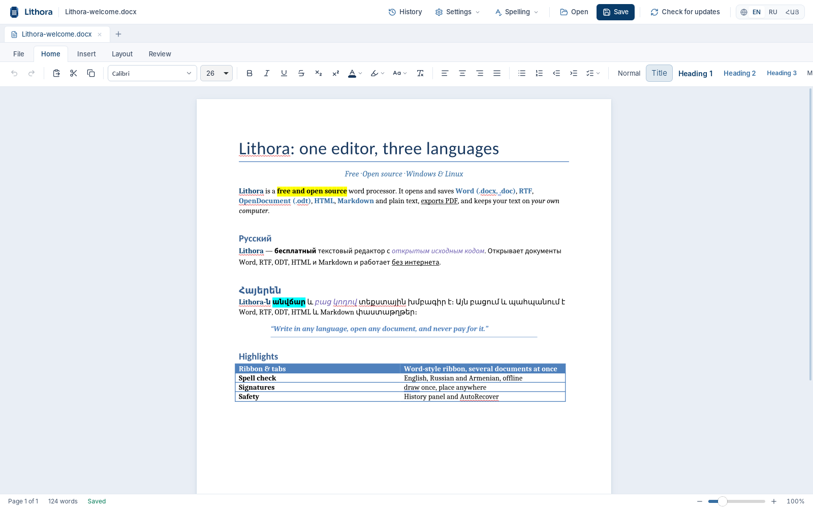
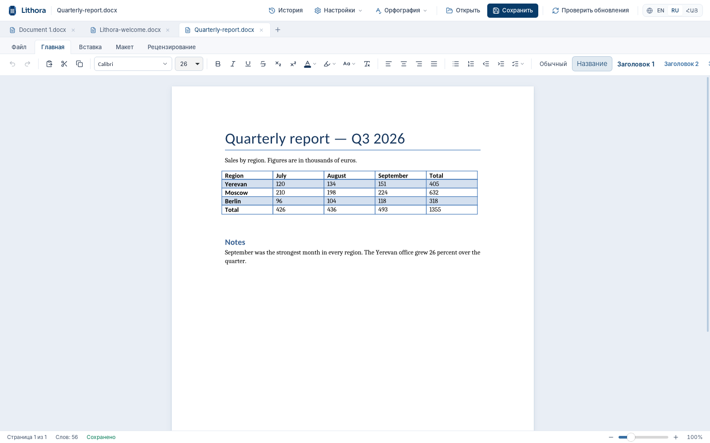

<p align="center">
  
</p>

<h1 align="center">Lithora</h1>

<p align="center">
  <strong>A free and open source word processor for Windows and Linux.</strong><br>
  Open, edit and save Word (.docx, .doc), RTF, OpenDocument (.odt), HTML, Markdown and text files,<br>
  export PDF, and write in English, Russian and Armenian.
</p>

<p align="center">
  <a href="https://github.com/Kisaragi000/Lithora/releases/latest"></a>
  
  <a href="#license"></a>
</p>

<p align="center">
  
</p>

Lithora is free to download, free to use and free to share. There are no accounts, no
subscriptions, no ads and no cloud: your documents stay on your computer. The full source code
is here on GitHub under the MIT and Apache-2.0 licenses.

> Lithora is young. It handles everyday documents well, but complex Word layouts may not look
> exactly the same yet. If a document comes out wrong, please
> [open an issue](https://github.com/Kisaragi000/Lithora/issues).

## Download

Get the latest version from the **[Releases page](https://github.com/Kisaragi000/Lithora/releases/latest)**.

| System | File |
|---|---|
| Windows 10 and 11 | `Lithora_<version>_x64-setup.exe` |
| Ubuntu, Debian, Mint | `Lithora_<version>_amd64.deb` |
| Fedora, openSUSE | `Lithora-<version>-1.x86_64.rpm` |
| Any Linux | `Lithora_<version>_amd64.AppImage` (make it executable, then run it) |

Lithora installs on its own: you don't need Microsoft Office, LibreOffice or anything else.
The Windows installer doesn't need administrator rights. Because the installer is not
code-signed yet, Windows SmartScreen may say the publisher is unknown; choose
**More info**, then **Run anyway**.

Lithora updates itself: click **Check for updates** in the title bar, and the new version
installs and restarts the app.

## Features

**Documents**
- Opens Word files (.docx, .docm, .dotx, .doc), RTF, OpenDocument (.odt), HTML, Markdown and
  plain text.
- Saves Word (.docx and .doc), RTF, OpenDocument, HTML, Markdown and text, and exports PDF.
- Keeps page layout, tables, columns, headers and footers as close to Word as it can.
- Armenian and Cyrillic text survives the trip through RTF and Word unchanged.

**Writing**
- A Word-style ribbon, with Table and Header & Footer tabs that appear when you need them.
- Several documents open at once, in tabs.
- Find and replace, change case (Shift+F3), comments and tracked changes.
- Spell check as you type in English, Russian and Armenian, with suggestions on right-click.
- Proofread panel with grammar and style checks for English, and basic checks for Russian and
  Armenian. Everything runs offline.

**Signing and printing**
- Draw your signature with a mouse, pen or finger, save it, and place it anywhere in a
  document.
- Print to any installed printer, with copies, page ranges and two-sided printing.

**Peace of mind**
- A History panel, like Photoshop's: click any earlier step to go back to it.
- AutoRecover keeps a copy of unsaved work and brings it back after a crash.
- A Recent files list, and the window remembers its size and place.

**Languages**
- The interface is available in English, Russian (Русский) and Armenian (Հայերեն).

<p align="center">
  
</p>

## Build from source

You need [Node.js](https://nodejs.org) 20 or newer, [Rust](https://rustup.rs), and the
[Tauri prerequisites](https://tauri.app/start/prerequisites/) for your system.

```sh
git clone https://github.com/Kisaragi000/Lithora.git
cd Lithora
npm install

npm run tauri dev     # run Lithora from source
npm run tauri build   # build installers (in src-tauri/target/release/bundle)
npm run lint          # type check
```

To build the Windows installer on Linux, install `nsis` and `mingw-w64`, run
`rustup target add x86_64-pc-windows-gnu`, then
`npm run tauri build -- --target x86_64-pc-windows-gnu --bundles nsis`.

### How it is built

Lithora is a [Tauri](https://tauri.app) app: the interface is React and TypeScript, and the
document engine is Rust. The engine is based on the open source crates of
[WordCraft](https://github.com/storytold/wordcraft), which read and write the file formats,
lay out pages and export PDF. Lithora adds its own interface, Armenian and Russian support,
signatures, printing and more on top.

| Path | What it holds |
|---|---|
| `src/desktop/` | The interface: ribbon, page view, dialogs, panels, translations |
| `src-tauri/src/` | The desktop shell: engine bridge, printing, proofreading, signatures, updates |
| `src-tauri/vendor/` | Lithora's patched copies of two WordCraft crates |
| `src-tauri/dictionaries/` | Russian and Armenian spelling dictionaries |
| `third-party/` | Licenses and notices of bundled third-party code and fonts |

### Releases

Raise the version number in `package.json`, `package-lock.json`, `src-tauri/Cargo.toml` and
`src-tauri/tauri.conf.json`, then merge to `main`. GitHub Actions builds the Windows and Linux
installers and publishes the release, and the app's update button picks it up. Merges that
keep the version number don't publish anything.

## Contributing

Bug reports, document samples that don't open correctly, translations and pull requests are
all welcome. Please open an [issue](https://github.com/Kisaragi000/Lithora/issues) to start.

## License

Lithora is free and open source software, licensed under either of

- MIT license ([LICENSE-MIT](LICENSE-MIT))
- Apache License, Version 2.0 ([LICENSE-APACHE](LICENSE-APACHE))

at your option. Unless you say otherwise, any contribution you submit for inclusion in
Lithora is dual licensed in the same way, without any additional terms or conditions.

## Credits

Lithora's document engine is built on [WordCraft](https://github.com/storytold/wordcraft)
(MIT OR Apache-2.0), and printing on its craft-print crate. English grammar checking uses [Harper](https://github.com/Automattic/harper)
(Apache-2.0). The Russian and Armenian dictionaries, the fonts and the other bundled code
are listed with their licenses in [THIRD-PARTY-NOTICES.md](THIRD-PARTY-NOTICES.md).
